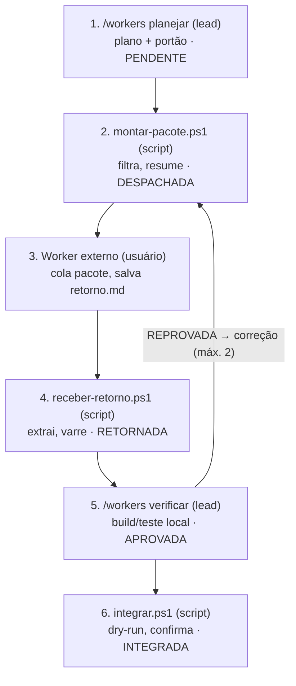

# PLANO — Plugin workers (v4)

claude-code-setup · 2026-11-10

## Plano por fases (leia primeiro)

Cada fase só começa se a anterior provar ganho real de tokens pagos, medido em uso real. O restante deste documento (seções 1 a 15) é a especificação de referência da Fase 1 em diante: não implementar nada dele antes do portão da Fase 0.

| Fase | Tipo | O que entra | Portão para avançar |
| --- | --- | --- | --- |
| 0 | Teste manual | Um único arquivo `workers/PACOTE.md` com o modelo de pacote (objetivo, contrato, trechos, critérios, formato de retorno) e uma tabela de medição. Nada de código, plugin ou script | Em 3 a 5 tarefas reais, economia de tokens pagos claramente acima do custo de preparar e verificar |
| 1 | Implementação mínima | Scripts de filtro (`montar-pacote.ps1`) e recepção (`receber-retorno.ps1`) + contratos `tests` e `docs` | Filtro bloqueia segredos nos testes; economia se mantém com menos esforço manual |
| 2 | Implementação | Skill `/workers`, estado, integração com dry-run; depois despacho opcional por API (chave em variável de ambiente, provedores aprovados) | Contadores mostram ganho sustentado; nenhum vazamento |
| 3 | Portabilidade | Núcleo neutro (Markdown, JSON, PowerShell) + instruções equivalentes para outra IA assumir o papel de lead quando a cota do Claude acabar | Fluxo retomado de verdade em outro ambiente a partir do estado em arquivo |

### Fase 0 — como executar

1. Escolher uma tarefa delimitada (ex.: testes de uma função isolada do projeto financeiro).
2. Pedir ao Claude para preencher `PACOTE.md` só com o necessário, sem dados reais.
3. Colar em outra IA gratuita (ChatGPT, Gemini, Grok…), pedindo a resposta no formato do modelo.
4. Trazer o resultado, rodar build e testes localmente, corrigir o mínimo.
5. Registrar na tabela: tarefa, tamanho do pacote, rodadas de correção, se o Claude teria feito mais barato direto.

Decisão ao fim da Fase 0: avançar para a Fase 1, ou parar e manter só o modelo manual.

### Fase 0 — arquivos prontos para o repositório

Dois arquivos, sem código: `workers/PACOTE.md` e `workers/MEDICAO.md`, ao lado deste plano (não é plugin ainda; vira recurso do plugin na Fase 1). Os testes atuais de links relativos e de conteúdo do pacote vão varrer esses arquivos: o modelo não pode conter nada com cara de segredo.

**`workers/PACOTE.md`** — o Claude preenche os campos entre `<>`, você copia tudo a partir de "Tarefa para você" e cola na outra IA.

````markdown
# Pacote para worker externo

<!-- Instruções para o Claude (lead), não copiar para o worker:
- Preencher só com o necessário para ESTA tarefa. Nunca repositório inteiro, CLAUDE.md inteiro ou histórico.
- Nunca incluir segredo, connection string, dado pessoal, dado financeiro real, nome de cliente, host interno ou path da máquina.
  Se o trecho precisar disso, trocar por exemplo fictício e avisar o usuário.
- Antes de entregar: listar arquivos/trechos incluídos, tamanho aproximado (caracteres) e o que foi removido.
- Gerar só se a tarefa passar no portão: gerar volume >> preparar + verificar. Senão, dizer que é melhor fazer direto.
-->

## Tarefa para você
Você vai executar uma tarefa delimitada. Você NÃO tem acesso ao projeto: use só o que está aqui.
Não afirme que compilou ou testou. Não crie arquivos fora da lista permitida.

- ID: <T001>
- Tipo: <tests | docs | refactor | review | generic>
- Objetivo: <uma frase>
- Stack: <ex.: .NET 10, xUnit>

## Contexto (somente o necessário)
<trechos de código com o caminho de cada um, ex.: `src/Dominio/Calculo.cs` linhas 10-58>

## Convenções
<nomes, estilo, um exemplo existente curto>

## Arquivos que você pode devolver
- <caminho/arquivo1>

## Critérios de aceite
- <critério verificável>

## Proibido
- Pedir ou supor o resto do projeto.
- Adicionar dependência não listada.
- Alterar comportamento fora do objetivo.

## Formato obrigatório da resposta
Responda exatamente neste formato. Resposta fora dele será descartada.

## Relatório
- Tarefa: <ID>
- Status: concluído | parcial | bloqueado
- Premissas:
- Não fiz / não sei:
- Dependências novas: nenhuma | <lista>

Para cada arquivo:
### arquivo: <caminho>
```<linguagem>
<conteúdo completo do arquivo>
```
````

**`workers/MEDICAO.md`** — uma linha por tarefa delegada.

| Data | Projeto | Tarefa | Tipo | Worker (IA) | Pacote (caracteres) | Rodadas de correção | Uso pago com delegação | Estimativa fazendo direto | Compensou? |
| --- | --- | --- | --- | --- | --- | --- | --- | --- | --- |
|  |  |  |  |  |  |  |  |  |  |

Como medir o uso pago: fazer cada tarefa delegada numa sessão limpa (`/clear` antes), anotar o tamanho da sessão ao final com `/context` (ou o indicador de uso do plano, antes e depois). Para a estimativa direta, comparar com uma tarefa parecida feita sem delegar. Não precisa ser exato; o portão pede ganho **claro**, não 5%.

**Prompt para iniciar a Fase 0** (colar no Claude Code, no clone do repositório):

> Leia `workers/PLANO.md`. Execute só a Fase 0: crie `workers/PACOTE.md` e `workers/MEDICAO.md` exatamente como especificado, rode os testes Pester existentes para garantir que nada quebrou (links e conteúdo do pacote) e mostre o diff. Não crie plugin, script nem altere outros arquivos. Commit só se eu pedir.

## O que muda da v3 para a v4

A v3 ficou completa, mas perdeu o motivo original: economizar tokens da sessão paga. Ela pede que o lead gere o prompt, leia o retorno inteiro, rode 11 estados e verifique 8 dimensões — isso pode custar mais do que fazer a tarefa direto. A v4 mantém a segurança da v3 e corta o que não serve à economia.

| Ponto da v3 | Problema | v4 |
| --- | --- | --- |
| Lead "gera prompt pronto para copiar" | O pacote inteiro sai como tokens de saída da sessão paga | Script monta o pacote em arquivo; o lead vê só o resumo |
| Usuário cola o retorno na conversa | O retorno inteiro entra como tokens de entrada | Usuário salva o retorno em arquivo; script extrai e aplica em staging |
| Relatório do worker com "comandos executados / saída observada" | Worker externo é um chat: não roda nada no projeto | Evidência é sempre local (build/teste rodados aqui); o relatório do worker é só declaração |
| Worker nativo + roteamento Haiku/Sonnet | Já coberto por `core/CLAUDE.md` e pelos agentes do `base`; consome a mesma cota paga | Fora do plugin; ele só aponta para os agentes existentes |
| 4 skills + `shared/` na raiz do plugin | Padrão do repo é recurso relativo dentro da pasta da skill (`revisar/lentes/`) | 1 skill `/workers` com modos, recursos na própria pasta |
| 11 estados | Burocracia para fluxo manual de uma pessoa | 7 estados |
| Sem critério de "vale delegar?" | Delega tarefa cuja verificação custa o mesmo que fazê-la | Portão de custo antes de cada subtarefa |

Base: leitura das três versões (v1, v2, v3) e do repositório atual (`core/CLAUDE.md`, `plugins/base`, `tests/`, `scripts/`).

## 1. Objetivo

Implementar no repositório `LeonardoPokrewecky/claude-code-setup` um plugin opcional `workers` que deixa a sessão paga do Claude Code só com o trabalho de julgamento (planejar, decidir, verificar) e manda o volume de geração para agentes externos gratuitos, por despacho manual. O lead continua responsável pelo resultado final.

O sucesso é medido por uma pergunta: **a demanda custou menos tokens pagos do que custaria feita direto, sem perder qualidade nem segurança?** Não é número de tarefas delegadas.

### Portão de custo (antes de cada subtarefa)

Delegar só quando o volume a gerar for bem maior que o custo de preparar e verificar. O lead registra a decisão em uma linha no plano.

| Bom candidato | Mau candidato |
| --- | --- |
| Testes unitários de funções puras/isoladas (verificação = rodar os testes) | Revisão de segurança, LGPD, autenticação, banco (julgamento crítico não vai para worker barato) |
| Documentação a partir de código já enviado no pacote | Mudança que exige ler muitos arquivos para dar contexto (pacote grande = vazamento + custo) |
| Refactor localizado com testes de regressão existentes | Tarefa curta: preparar + verificar custa mais que fazer |
| Boilerplate repetitivo (mapeamentos, DTOs, fixtures fictícias) | Review genérico de código: verificar cada achado custa quase o mesmo que revisar |

Se o portão reprovar, o lead faz direto ou usa os agentes do plugin `base` (regra já existente em `core/CLAUDE.md`: delegar quando o volume a ler for muito maior que o resultado).

## 2. Restrições explícitas

Violar qualquer uma reprova a implementação, mesmo que o resto funcione.

1. **Despacho externo é manual até a Fase 2.** Nada de login, navegador ou automação em conta de outra IA. API oficial só no fim da Fase 2, nas condições da seção 15.1. O plugin produz arquivos; o usuário copia e cola.
2. **Nenhum plugin, skill ou script de terceiros no caminho crítico.** Repositórios community podem ser estudados; o código é escrito aqui. Sem download ou execução remota.
3. **Worker não aprova nem integra o próprio trabalho.** Status declarado pelo worker não muda estado; só a verificação local muda.
4. **Pacote externo nunca leva:** repositório inteiro, `CLAUDE.md` inteiro, histórico Git, segredos, dados pessoais, dados reais, nomes de cliente, hosts/URLs internos, paths de máquina.
5. **Projeto de cliente bloqueia despacho externo por padrão.** Critério: linha `Documentação:` do `CLAUDE.md` do projeto apontando para pasta só local (regra já existente no README). Liberar exige flag por demanda no plano, com motivo registrado.
6. **Pacote mostrado e confirmado antes de sair.** Filtro automático é defesa contra acidente, não garantia de anonimização.
7. **Nada escrito no projeto sem dry-run + confirmação**, no mesmo padrão dos scripts atuais (`-DryRun` → código → `-Confirmar <código>`, SHA-256, backup).
8. **Plugin desligado por padrão** (`defaultEnabled: false`), ligado só pela camada `project-templates/workers`. Sem tocar em `base`, `dotnet`, `angular`, `core/CLAUDE.md` (limite de 40 linhas testado) nem `core/settings.merge.json`.
9. **Respeitar as regras globais existentes:** Haiku nunca edita código; nunca dois agentes nos mesmos arquivos; commit/push/deploy só a pedido; hook `bloquear-segredos` e permissões nunca contornados.
10. **Portabilidade:** Windows PowerShell 5.1, PowerShell 7, Linux e macOS. Scripts em PowerShell como os demais do repositório.
11. **Estado nunca dentro da pasta do plugin** nem versionado em projeto de cliente.

## 3. Fora do escopo (Fases 0 a 2)

- Orquestrar subagentes nativos (eles já existem no `base` e gastam a mesma cota paga). O plano pode marcar uma subtarefa como "lead direto" ou "agente `base:<nome>`", e o plugin para por aí.
- Roteamento automático de modelo.
- Paralelismo de escrita. Duas subtarefas que alteram arquivos rodam em sequência; só tarefas sem arquivo em comum podem ser despachadas juntas.
- Grafo de dependências com caminho crítico. Basta `depende de: T00x` por subtarefa.
- Evals adversariais completos.
- Qualquer automação de cópia para o worker além de `Set-Clipboard` local (opcional); a única exceção é a API do fim da Fase 2.

## 4. Descoberta obrigatória (somente leitura)

Antes de criar qualquer arquivo, confirmar no repositório real e entregar um mapa de compatibilidade. Se algo divergir desta especificação, vence o repositório: registrar a divergência e propor a adaptação mínima.

| O que confirmar | Onde | Por que importa |
| --- | --- | --- |
| Formato de marketplace e manifest, campo `defaultEnabled` | `.claude-plugin/marketplace.json`, `plugins/dotnet/.claude-plugin/plugin.json` | Plugin off por padrão |
| Como uma skill acha arquivos auxiliares e scripts após instalação (link relativo; variável tipo `${CLAUDE_PLUGIN_ROOT}` disponível em skill ou só em hook) | `plugins/base/skills/revisar/` (lentes), `plugins/base/hooks/hooks.json` | Decide se os scripts rodam por caminho do plugin ou se a skill instrui o caminho |
| Convenção de skill: `disable-model-invocation: true`, `argument-hint` entre aspas, "Só roda com /x" | `plugins/base/skills/*/SKILL.md`, `tests/estrutura.Tests.ps1` | Skill só por comando explícito, sem custo de auto-invocação |
| Padrões de segredo e termos proibidos reutilizáveis | `plugins/base/hooks/bloquear-segredos.ps1`, `tests/conteudo-pacote.Tests.ps1` (lista externa `termos-proibidos.txt`) | Filtro do pacote não reinventa regex |
| Padrão dry-run / código / SHA-256 / backup | `scripts/instalar-arquivos.ps1`, `scripts/merge-settings.ps1` | Script de aplicação segue o mesmo contrato |
| Permissões: o que o settings libera ou pede para `pwsh -File` | `core/settings.merge.json` | Saber se cada script vai pedir confirmação (esperado e aceitável) |
| Skills e agentes reaproveitáveis | `laudo-de-evidencia`, `criar-testes`, `revisar`, `session-handoff`; agentes `revisor`, `test-validator-haiku`, `documentation-haiku` | Não duplicar |
| Geração de inventário e testes de links | `scripts/gerar-docs.ps1`, `componentes.md` | Teste de documentação atualizada |

Saída da etapa: mapa acima preenchido, lista de arquivos a criar/alterar, riscos. **Parar e aguardar aprovação.**

## 5. Arquitetura

Uma skill com modos, recursos na própria pasta e scripts determinísticos para tudo que é mecânico. Script não gasta token: montar pacote, varrer segredos, extrair retorno, comparar arquivos e rodar build ficam fora do modelo. O lead só lê resumos.

```text
plugins/workers/
  .claude-plugin/plugin.json
  README.md
  skills/workers/
    SKILL.md                 # /workers <modo> [args]; roteia para o arquivo do modo
    modos/
      planejar.md            # quebra a demanda, portão de custo, contratos
      pacote.md              # chama montar-pacote.ps1 e mostra o resumo
      verificar.md           # chama receber-retorno.ps1, roda build/teste, decide
      integrar.md            # dry-run e aplicação do aprovado
      status.md              # lê o estado e diz o próximo passo
    contratos/               # tests.md, docs.md, refactor.md, review.md, generic.md
    modelos/                 # prompt-worker.md, retorno-worker.md, plano.md, tarefa.md
    scripts/
      montar-pacote.ps1
      receber-retorno.ps1
      integrar.ps1
      estado.ps1

project-templates/workers/.claude/settings.json   # liga workers@kit-dev-ia
```

Por que uma skill só: o padrão do repositório já é skill com modos e arquivos relativos (`/revisar` + `lentes/` + `modo-pr.md`), coberto pelo teste de links relativos. Cada modo carrega só o seu arquivo, então o custo de instrução por chamada fica pequeno. Se a descoberta mostrar que skills separadas resolvem recursos melhor, separar — mas sem pasta solta na raiz do plugin.

### Estado da demanda (fora do plugin)

Local = pasta da linha `Documentação:` do `CLAUDE.md` do projeto, subpasta `workers/`. Sem a linha: perguntar uma vez, como as skills atuais já fazem.

```text
<documentação>/workers/<AAAA-MM-DD>-<slug>/
  plano.md            # objetivo, subtarefas, portão de custo, flags, decisões
  estado.json         # estado por subtarefa + log de transições (escrito só por estado.ps1)
  T001/
    pacote.md         # o que sai para o worker (gerado)
    pacote.resumo.txt # arquivos, tamanho, ~tokens, itens bloqueados
    retorno.md        # o usuário salva aqui a resposta do worker
    staging/          # arquivos extraídos do retorno
    verificacao.md    # decisão + evidência local
```

## 6. Fluxo e papéis

O conteúdo (pacote e retorno) anda por arquivo entre scripts e usuário; o lead só entra para planejar e decidir, lendo resumos.



Estados fora do caminho feliz: `CANCELADA` a partir de qualquer estado não terminal; bloqueio é um campo, não um estado. Revisor independente = o próprio lead com build/teste local ou os agentes `revisor` e `test-validator-haiku`, nunca o worker que produziu.

## 7. Contratos

Cinco contratos com o mesmo esqueleto. O que muda entre eles é o que o worker recebe, o que devolve e como o lead verifica **localmente**.

```markdown
# Contrato: <nome>
## Quando usar / quando não usar (inclui o portão de custo)
## Entrada mínima (o que o pacote leva)
## Arquivos que o worker pode devolver (lista fechada)
## Formato do retorno (aponta para modelos/retorno-worker.md)
## Verificação local (comandos e checagens do lead)
## Critérios de aceite
## Proibido
```

| Contrato | Pacote leva | Worker devolve | Verificação local (barata) |
| --- | --- | --- | --- |
| `tests` | Assinaturas e corpo das funções-alvo, framework de teste, um teste existente como exemplo de convenção, casos obrigatórios | Arquivos de teste novos; lista de cenários cobertos e não cobertos | Build + rodar só os testes novos; contagem executados > 0 e nenhum pulado; testes antigos continuam passando. Sem cobertura percentual inventada |
| `docs` | Código-fonte que é a fonte de verdade, público, destino, formato | Arquivos `.md` | Script confere que todo caminho, comando e símbolo citado existe no projeto; lead lê só o que o script marcou |
| `refactor` | Trecho-alvo, comportamento que não pode mudar, restrições de arquitetura | Arquivos alterados (inteiros) | Diff só dentro da lista permitida; contratos públicos inalterados; build + testes de regressão existentes passam |
| `review` | Diff ou trecho + uma lente de `revisar/lentes/` | Achados `[ALTA\|MÉDIA\|BAIXA] caminho:linha — problema — correção` (mesmo formato do agente `revisor`) | Script confere que cada `caminho:linha` existe; lead confirma só os ALTA. Lentes segurança, LGPD e arquitetura **não** saem para worker externo |
| `generic` | Definido pelo lead no plano | Definido pelo lead | Lead escreve a verificação antes de despachar; sem ela, o modo `pacote` recusa |

O formato de retorno é único (`modelos/retorno-worker.md`), para o script conseguir extrair:

````markdown
## Relatório
- Tarefa: T001
- Contrato: tests
- Status declarado: concluído | parcial | bloqueado
- Premissas:
- Não fiz / não sei:
- Dependências novas: nenhuma | <lista>

### arquivo: tests/Unit/CalculoTests.cs
```csharp
...conteúdo completo...
```
````

O prompt do worker termina dizendo: arquivo fora da lista permitida ou sem o cabeçalho `### arquivo:` é descartado; o worker não tem acesso ao projeto e não deve afirmar que compilou ou testou.

## 8. Pacote de saída e filtro (`montar-pacote.ps1`)

O lead escreve só a ficha da subtarefa (`T001/tarefa.md`: objetivo, contrato, caminhos com faixa de linhas, critérios). O script monta o pacote; o conteúdo dos arquivos nunca passa pela saída do modelo.

1. Lê a ficha e o contrato; junta o modelo `prompt-worker.md` + trechos listados (`caminho:inicio-fim`). Nada além da lista.
2. Recusa caminhos negados: os mesmos do `deny` do settings e do hook (`.env*`, chaves, `secrets/`, `appsettings` de ambiente real, `bin/`, `obj/`, `node_modules/`, dumps, logs).
3. Varre o conteúdo: padrões de segredo de `conteudo-pacote.Tests.ps1`, termos proibidos da lista externa, e mais CPF, CNPJ, e-mail, IP privado, hostname interno, path absoluto de máquina, connection string.
4. Qualquer achado **bloqueia** o pacote. Saída só com `arquivo:linha` + tipo, nunca o valor. Para liberar, o lead ajusta a ficha (tira o trecho ou o substitui por exemplo fictício) — o script não "anonimiza sozinho".
5. Projeto de cliente sem flag no plano: bloqueia antes de ler qualquer arquivo.
6. Grava `pacote.md` e `pacote.resumo.txt` (arquivos, linhas, caracteres, ~tokens = caracteres/4, limite configurável com aviso, padrão 40 mil caracteres).
7. Mostra o resumo e um código de confirmação. Só com `-Confirmar <código>` marca a subtarefa como `DESPACHADA` e, se pedido (`-Copiar`), usa `Set-Clipboard`. O código muda se o pacote mudar.

O lead mostra ao usuário apenas o resumo. O usuário abre `pacote.md`, revisa se quiser e cola no worker.

## 9. Retorno e verificação

A verificação é local e baseada no que o lead consegue reproduzir. O que o worker afirma sobre si é ignorado como prova.

### 9.1 Recepção (`receber-retorno.ps1`, sem modelo)

O usuário salva a resposta do worker em `T001/retorno.md` (não cola na conversa). O script:

- Reprova se faltar o bloco `## Relatório` ou algum campo obrigatório.
- Extrai cada `### arquivo:` para `staging/`. Rejeita caminho absoluto, `..`, caminho fora da lista permitida e arquivo duplicado.
- Roda a mesma varredura de segredos do pacote no retorno (worker pode inventar credencial de exemplo).
- Detecta dependência nova (`PackageReference`, `package.json`, `using`/`import` de pacote ausente) e marca para decisão.
- Gera um resumo curto: arquivos aceitos, rejeitados, diff stat contra o projeto, alertas. **É isso que o lead lê**, não o retorno inteiro.

### 9.2 Decisão (modo `verificar`)

O lead aplica a verificação local do contrato. Build e testes rodam numa cópia de trabalho com o staging aplicado (ou via agente `test-validator-haiku`, que só roda e relata). O lead lê código do staging apenas onde o contrato exige julgamento, por trecho.

| Situação | Decisão |
| --- | --- |
| Relatório ausente/incompleto, arquivo fora do escopo, segredo no retorno | REPROVADA automática |
| Build ou teste falhou | REPROVADA, com o trecho literal do erro para o pedido de correção |
| Ambiente não permite rodar | No máximo PARCIAL, item "não verificado" registrado. Nunca APROVADA |
| Tudo do contrato comprovado localmente | APROVADA |

`verificacao.md` segue o formato do `laudo-de-evidencia` (caso, esperado, obtido, veredito, evidência, não verifiquei), em vez de criar outro formato.

Retrabalho: o modo `pacote` gera um pacote de correção pequeno (só o erro + arquivos afetados). Limite de 2 rodadas por subtarefa; depois disso, o lead faz direto e registra "delegação não compensou".

## 10. Integração no projeto (`integrar.ps1`)

Só subtarefas APROVADAS entram. O script segue o contrato de `instalar-arquivos.ps1`:

1. `-DryRun`: lista cada arquivo como NOVO, ALTERADO ou IGUAL (SHA-256), mostra o diff dos alterados e um código.
2. Confere que o arquivo no projeto ainda é o mesmo de quando o pacote foi montado (SHA-256 guardado no `estado.json`). Mudou desde então: **para**, mostra o conflito e pede decisão. Nunca mescla sozinho.
3. `-Confirmar <código>`: backup dos ALTERADOS em `<documentação>/workers/<demanda>/backup/`, copia, confere SHA-256.
4. Depois: build + testes do projeto (comandos do `CLAUDE.md`). Falhou: estado continua APROVADA, resultado registrado, backup indicado para reverter.
5. Passou: estado INTEGRADA. Sugerir `/revisar` no diff final (o usuário digita). Commit, push e deploy só a pedido.

Dependência nova aprovada no retorno não é instalada pelo script: vira passo explícito para o usuário, seguindo o `ask` de instalação já existente.

## 11. Estado e retomada

Sete estados por subtarefa, transições no diagrama da seção 6: `PENDENTE`, `DESPACHADA`, `RETORNADA`, `APROVADA`, `REPROVADA`, `INTEGRADA`, `CANCELADA`. Bloqueio não é estado: é um campo `bloqueio: <motivo>` que impede a próxima transição.

- `estado.json` é escrito **só** por `estado.ps1`, que recusa transição inválida. O modelo nunca edita o JSON à mão.
- Cada transição grava: data/hora, de → para, quem (lead | usuário | script). Motivo obrigatório só em `REPROVADA`, `CANCELADA` e em bloqueio.
- `APROVADA` só é aceita se `verificacao.md` existir com veredito aprovado; `INTEGRADA` só vem de `integrar.ps1`.
- Guarda SHA-256 dos arquivos de entrada no momento do pacote (base para detectar conflito na integração).
- Guarda contadores para avaliar a economia: caracteres enviados, caracteres recebidos, rodadas de retrabalho, decisão do portão.
- Retomada: `/workers status` lê `plano.md` + `estado.json` e diz o próximo passo de cada subtarefa. Substitui o handoff para a orquestração; `/session-handoff` continua valendo para o resto.
- Cancelar nunca apaga pacote, retorno ou evidência.

## 12. Testes obrigatórios

Pester, em `tests/workers.Tests.ps1`, rodando no CI existente (`.github/workflows/tests.yml`). Como a lógica crítica está em scripts, ela é testável de verdade — não só "o frontmatter existe". Todos os dados de teste são fictícios.

| Área | Casos mínimos |
| --- | --- |
| Estrutura | Manifest e marketplace válidos; `defaultEnabled: false`; frontmatter da skill; links relativos para modos, contratos e modelos resolvem (testes existentes já cobrem parte) |
| `montar-pacote.ps1` | Bloqueia `.env`, chave privada, token, connection string, CPF, CNPJ, e-mail, path absoluto, termo proibido; saída não contém o valor encontrado; projeto de cliente sem flag é bloqueado; só inclui trechos listados; código de confirmação muda quando o pacote muda |
| `receber-retorno.ps1` | Reprova sem relatório; rejeita `..`, caminho absoluto e arquivo fora da lista; detecta segredo no retorno; extrai arquivos corretos |
| `estado.ps1` | Transições válidas passam e inválidas falham (ex.: `PENDENTE → APROVADA`, `RETORNADA → INTEGRADA`); `APROVADA` sem `verificacao.md` falha; retomada lê o último estado; cancelar preserva arquivos |
| `integrar.ps1` | Subtarefa não aprovada é recusada; dry-run não escreve nada; código errado não escreve nada; arquivo alterado depois do pacote gera conflito e para; backup existe antes da cópia |
| Portabilidade | Os testes de script rodam em `pwsh` e em Windows PowerShell 5.1 (UTF-8 sem BOM, caminhos com acento) |

Um eval no formato de `plugins/base/evals/` (prompt + graders) para o modo `planejar`: dada uma demanda com parte LGPD, o plano não manda essa parte para worker externo e registra o portão de custo.

## 13. Critérios de aceite

| ID | Critério | Como se comprova |
| --- | --- | --- |
| A1 | Plugin instalável pelo `kit-dev-ia`, desligado por padrão, ligado só pela camada `workers` | Teste de estrutura + `claude plugin validate` quando o CLI existir |
| A2 | Conteúdo de arquivo do projeto nunca é gerado pelo modelo para montar o pacote, nem o retorno inteiro é lido pelo lead por padrão | Revisão dos arquivos de modo: eles chamam os scripts e leem só os resumos |
| A3 | Pacote com segredo, dado pessoal ou termo proibido é bloqueado sem expor o valor | Testes de `montar-pacote.ps1` |
| A4 | Projeto de cliente não despacha sem flag registrada no plano | Teste de `montar-pacote.ps1` |
| A5 | Retorno sem relatório, fora do escopo ou com segredo é reprovado sem intervenção do modelo | Testes de `receber-retorno.ps1` |
| A6 | Nenhuma subtarefa chega a APROVADA sem evidência local; ambiente sem testes = no máximo PARCIAL | Teste de `estado.ps1` + modo `verificar` |
| A7 | Integração só de aprovadas, com dry-run, código, backup e detecção de conflito | Testes de `integrar.ps1` |
| A8 | Demanda interrompida é retomada por `/workers status` | Teste de retomada |
| A9 | Portão de custo e contadores registrados em toda demanda | Eval do modo `planejar` + campo no `estado.json` |
| A10 | Nada alterado em `base`, `dotnet`, `angular`, `core/`; sem commit/push | Diff final revisado |
| A11 | Testes passam no CI em `pwsh`; execução em PowerShell 5.1 documentada (passou ou não testado) | Saída do CI + README |
| A12 | README do plugin: fluxo, quando vale delegar, segurança, limitações; `componentes.md` regenerado | Teste de documentação atualizada |

## 14. Ordem de implementação por fase

Cada fase tem duas metades: **implementar** (com testes automatizados) e **validar em uso real** (tarefas de verdade, registradas em `MEDICAO.md`). A fase seguinte só começa com o portão da tabela do topo cumprido e com sua aprovação explícita. Toda fase começa pela descoberta da seção 4, restrita ao que ela vai tocar.

### Fase 1 — scripts mínimos (critérios A3, A4, A5, A10, A11)

1. Descoberta e plano de arquivos. Parar e aguardar aprovação.
2. `montar-pacote.ps1` + testes de filtro (seção 8), lendo uma ficha simples por tarefa.
3. `receber-retorno.ps1` + testes (seção 9.1), extraindo para `staging/`.
4. Contratos `tests` e `docs` (seção 7); `PACOTE.md` passa a ser o modelo usado pelo script.
5. Ainda sem skill, sem estado e sem integração automática: você chama os scripts e o Claude verifica e aplica com o fluxo normal.
6. Validar em uso real: 3 a 5 tarefas, comparando com a Fase 0 na `MEDICAO.md`.

### Fase 2 — plugin completo, depois API (critérios A1, A2, A6–A9, A12)

1. `estado.ps1` + testes (seção 11).
2. `integrar.ps1` + testes (seção 10).
3. Contratos `refactor`, `review`, `generic`.
4. Skill `/workers` com os modos; manifest, marketplace, camada `project-templates/workers`; eval do modo `planejar`; README e `gerar-docs.ps1`.
5. Validar em uso real com o plugin ligado num projeto.
6. Só depois disso, e se os contadores ainda mostrarem ganho: despacho por API (seção 15.1), seguido de nova validação.

### Fase 3 — portabilidade (seção 15.2)

1. Mover o núcleo neutro para fora do plugin e deixar o plugin como casca.
2. Escrever as instruções equivalentes para outro lead.
3. Validar: interromper uma demanda no Claude e concluí-la em outra ferramenta, só a partir dos arquivos.

Regras em todas as fases: checklist persistente; falha preserva evidência; nada de contornar hook ou permissão; incompleto é PARCIAL; ao fim, revisão do diff (`/revisar auto`) e relatório com testes executados (saída literal), não verificado e pendências.

## 15. Fases 2 e 3 — especificação preparada

Só entram se os contadores das fases anteriores mostrarem ganho. Se não mostrarem, o certo é simplificar, não expandir.

### 15.1 Despacho por API (fim da Fase 2)

A automação não economiza mais tokens por tarefa: economiza o seu tempo de copiar e colar. O ganho vem de delegar mais vezes com menos atrito.

- Novo script `despachar.ps1`: recebe um pacote **já filtrado e confirmado** e grava a resposta direto em `retorno.md`. Dali em diante o fluxo é o mesmo (recepção, verificação local, integração).
- Provedores só de uma lista aprovada por você num arquivo de configuração local (fora do repositório), ex.: Gemini, OpenAI, Groq.
- Chave sempre em variável de ambiente; nunca em arquivo versionado, log, pacote ou estado. O hook de segredos continua valendo.
- Confirmação por envio continua obrigatória (mesmo código de confirmação do pacote).
- Antes de habilitar um provedor: conferir os termos de uso dele para envio de código e uso do plano gratuito. Nada de rotas não oficiais, proxies de terceiros ou gateways tipo hub que interceptam a sessão do Claude Code.
- Rede é `ask` no setup atual: a chamada vai pedir permissão, e isso é desejado.
- Evolução opcional: provedor preferido por contrato (ex.: `tests` num, `docs` noutro), escolhido pelos números da `MEDICAO.md`.

### 15.2 Portabilidade do lead (Fase 3)

Objetivo: se a cota do Claude acabar, outra ferramenta (Codex, Gemini CLI ou outra) assume o papel de lead e continua a demanda de onde parou.

- Núcleo neutro em Markdown, JSON e PowerShell: contratos, modelos, scripts e estado. Nenhuma dependência de recurso exclusivo do Claude Code no núcleo.
- O plugin do Claude vira casca fina que chama o núcleo. Para outra ferramenta, um arquivo de instruções equivalente (ex.: `AGENTS.md`) apontando para os mesmos contratos e scripts.
- O estado em arquivo (`plano.md`, `estado.json`) é o que permite retomar; nada depende do histórico de conversa.
- As mesmas regras valem para qualquer lead: verificação local, filtro, confirmação, nada de commit sem pedido.
- Portão: uma demanda real interrompida no Claude e concluída em outra ferramenta, só a partir dos arquivos.

### Pendências registradas

- Orquestração de subagentes nativos no mesmo fluxo.
- Escrita em paralelo com reserva de arquivos e dependências em mais de um nível.
- Evals adversariais para todos os modos.
- Mais contratos (fixtures, tradução de docs).

---

**Como usar este documento:** em cada etapa, abrir o Claude Code no clone do `claude-code-setup` e pedir: "Leia `workers/PLANO.md` e execute só a Fase N, começando pela descoberta; pare e aguarde aprovação antes de alterar arquivos." A Fase 0 tem prompt próprio na seção "Fase 0 — arquivos prontos para o repositório".
